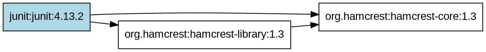
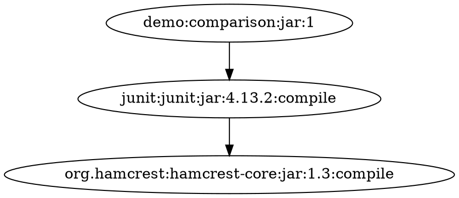
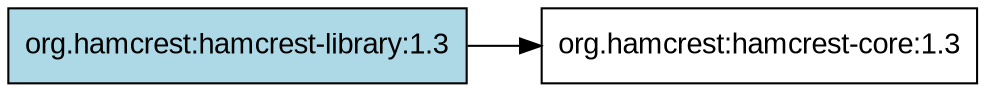
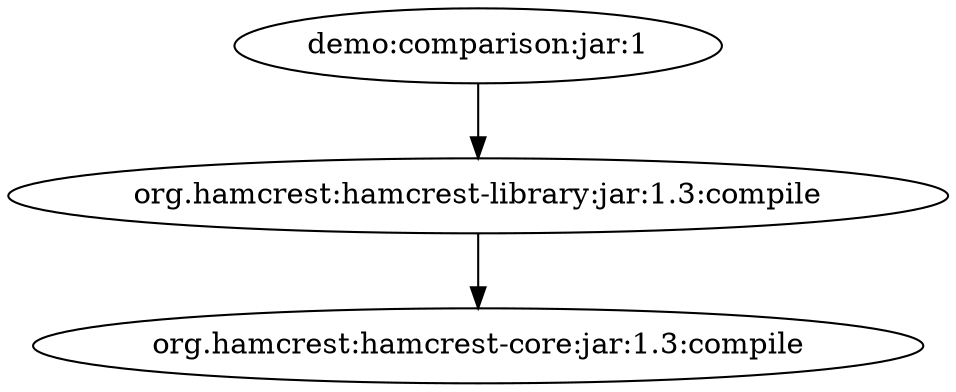
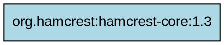
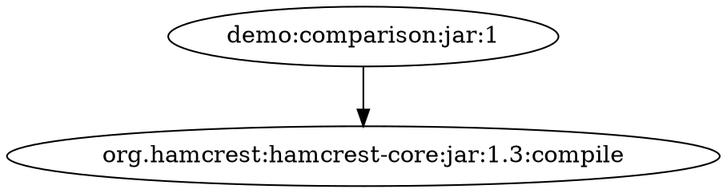

# Сравнение визуализации с Maven

Проверка выполнена 17.11.2026. Использованы Maven 3.9.16,
maven-dependency-plugin 3.8.1, Graphviz 16.1.1 и репозиторий
https://repo1.maven.org/maven2/. Наш анализатор получает зависимости
самостоятельно; Maven запускался только для независимого сравнения.

Для каждого пакета создан маленький проект demo:comparison:1 с одной
прямой зависимостью. Из Maven выполнена штатная команда dependency:tree
с outputType=dot. Сохранены реальные DOT, а не вручную составленный эталон.

Повторение (PowerShell, нужны отдельно установленные Maven, Java, Graphviz):

```powershell
mvn -f examples/maven/junit/pom.xml dependency:tree -DoutputType=dot -DoutputFile=maven.dot
mvn -f examples/maven/hamcrest-library/pom.xml dependency:tree -DoutputType=dot -DoutputFile=maven.dot
mvn -f examples/maven/hamcrest-core/pom.xml dependency:tree -DoutputType=dot -DoutputFile=maven.dot
dot -Tpng examples/maven/junit/maven.dot -o output/maven-junit.png
```

В pom.xml каждого проекта закреплена версия плагина 3.8.1.
При проблемах доступа к Maven Central можно задать mirror на repo1.maven.org
через пользовательский settings.xml. Настройки проверки TLS не отключались.

При сопоставлении исключен служебный корень demo:comparison:1;
в подписях Maven group:artifact:type:version:scope оставлены group:artifact:version.

## junit:junit:4.13.2

Наш DOT:



Штатный DOT Maven:



Наш результат: 3 вершины, 3 ребра. Maven: 2 вершины, 1 ребро после исключения служебного проекта. У нас
также есть hamcrest-library:1.3 и его связь с hamcrest-core. Это test-зависимость самого JUnit; через
внешний проект Maven не переносит ее транзитивно. Наш анализатор включает все объявления scope. Поэтому
это ожидаемое различие.

## org.hamcrest:hamcrest-library:1.3

Наш DOT:



Штатный DOT Maven:



После исключения служебного проекта оба результата содержат 2 вершины и связь hamcrest-library -> hamcrest-core.

## org.hamcrest:hamcrest-core:1.3

Наш DOT:



Штатный DOT Maven:



После исключения служебного проекта оба результата содержат только hamcrest-core, без ребер зависимостей.
